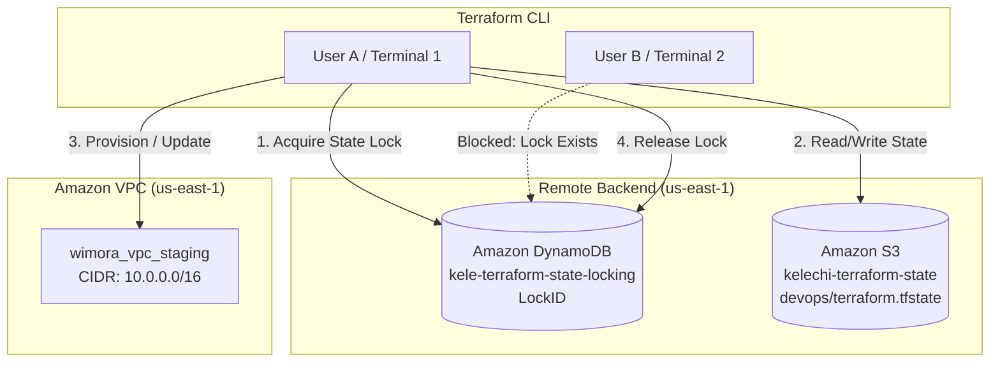

# AWS VPC Infrastructure with Remote State & DynamoDB Locking

A modular AWS Virtual Private Cloud (VPC) provisioned via Terraform, backed by remote Amazon S3 state storage and DynamoDB distributed locking to prevent race conditions and state corruption during team execution.

---

## Architecture



The configuration isolates state management from the local developer workstation. Amazon S3 holds the remote `.tfstate` file, while Amazon DynamoDB uses a dedicated `LockID` primary key to enforce mutual exclusion. When a process initiates an execution cycle, it writes an active lock item to DynamoDB; any concurrent process attempting an apply is blocked until the active lock is cleared.

---

## Tech Stack

* **IaC Engine:** Terraform (>= 1.5.0)
* **Cloud Provider:** Amazon Web Services (AWS)
* **State Storage:** Amazon S3 (`kelechi-terraform-state`)
* **Concurrency Control:** Amazon DynamoDB (`kele-terraform-state-locking`)
* **Network Resources:** AWS VPC (`10.0.0.0/16`)

---

## What I Built

* **Remote State Backend:** Configured an S3 backend target at `devops/terraform.tfstate` to centralize infrastructure state and eliminate uncommitted local state files.
* **Distributed State Locking:** Implemented DynamoDB table locking to prevent simultaneous applies from creating race conditions or corrupting the JSON state ledger.
* **Custom Staging VPC:** Provisioned a `/16` CIDR block virtual network (`wimora_vpc_staging`) with default tenancy and proper environment tagging for resource tracking.

---

## Project Structure

```text
.
├── main.tf        # AWS provider and VPC definition
├── backend.tf     # S3 remote backend and DynamoDB lock configuration
└── README.md
```

---

## How to Run It

### Prerequisites

* AWS CLI installed and configured (`aws configure`) with credentials for `us-east-1`
* Terraform >= 1.5.0 installed
* S3 bucket `kelechi-terraform-state` and DynamoDB table `kele-terraform-state-locking` pre-created in AWS

### 1. Initialize Backend

Initialize the working directory to download the AWS provider and connect to the remote S3/DynamoDB backend:

```bash
terraform init
```

### 2. Review and Deploy

Generate the execution plan and apply the configuration:

```bash
terraform plan
terraform apply
```

---

## How to Test Distributed Locking

To verify that DynamoDB successfully prevents concurrent execution:

1. **Terminal 1:** Run `terraform apply` and stop when it prompts `Enter a value:`. Leave this terminal open without typing `yes`.
2. **Terminal 2:** Open a second terminal window in the same directory and run `terraform apply`.
3. **Result:** Terminal 2 will immediately exit with an error confirming the state lock is held:

```text
Error: Error acquiring the state lock
Lock Info:
  Path:      kelechi-terraform-state/devops/terraform.tfstate
  Operation: OperationTypeApply
  Who:       user@hostname
```

4. Return to **Terminal 1**, type `yes` to complete (or `no` to cancel), which automatically releases the lock from DynamoDB.

---

## Cleanup

To tear down the provisioned VPC and clean up cloud resources:

```bash
terraform destroy
```

---

## Key Takeaways

* **State Concurrency:** Hands-on verification of how Terraform uses DynamoDB conditional writes to prevent state corruption when multiple operators run simultaneous commands.
* **Separation of State:** Storing `.tfstate` remotely prevents accidental exposure of sensitive infrastructure data in local version control.
* **Naming Consistency:** Kept state keys structured under environment paths (`devops/terraform.tfstate`) to allow multi-project state sharing within the same S3 bucket.